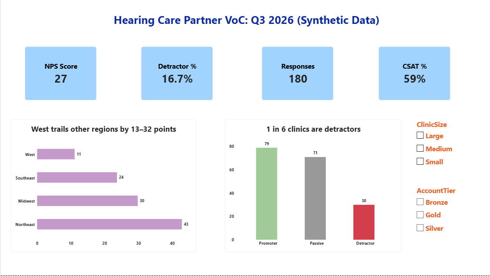
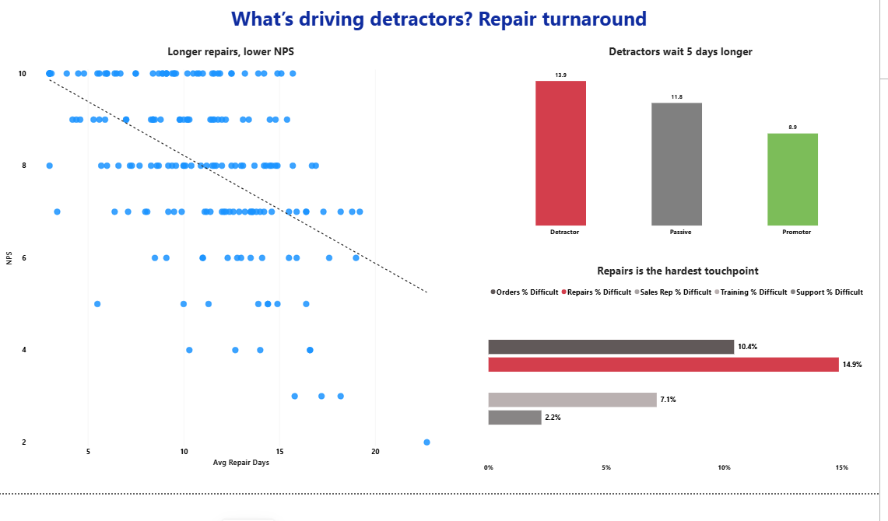

# Hearing Care Partner Voice of Customer (VoC) Project

An end-to-end Voice of Customer project for a hearing aid manufacturer's B2B customers (hearing care clinics): a survey designed and built in **Qualtrics**, analysis in **Python**, and a **Power BI** dashboard that turns the results into an action list.

> **Note:** This is an independent practice project. It is not connected to any company. All responses and operational data are **synthetic** (made up in Python with known patterns), so I could test whether my analysis finds the real drivers.

---

## The question

Which parts of the clinic experience make clinics unhappy, and which clinics should we call first?

## What I found

| Metric | Result |
|---|---|
| NPS | **+27** (180 clinic responses, 60% response rate) |
| Detractors | **16.7%** (about 1 in 6 clinics) |
| CSAT | **59%** satisfied or extremely satisfied |

1. **Slow repairs are the biggest reason clinics are unhappy.** Detractors wait 13.9 days for repairs vs 8.9 days for promoters. Repair time has the strongest link to NPS (correlation −0.52), ahead of order delays (−0.31) and support tickets (−0.25).
2. **The survey says the same thing as the operations data.** Repairs is the hardest touchpoint: 14.9% of clinics rate it difficult, the highest of the five. Ordering is second at 10.4%.
3. **The West region is most at risk.** West NPS is +11 vs +43 in the Northeast.
4. **Sales rep visits are the strength.** 96% of clinics rate them easy, and none rate them difficult.

**Action:** 18 detractors agreed to be contacted. The Action List ranks them by account tier, then lowest score, and shows each clinic's repair and order data so the caller knows the likely problem before dialing.

## Dashboard

**Overview**: headline KPIs, NPS by region, promoter / passive / detractor split

**Drivers**: repair days vs NPS, repair wait by NPS group, % difficult by touchpoint

**Action List**: detractors who agreed to follow-up, with red flags on long repairs and order delays

## How I built it

### 1. Survey design (Qualtrics)
- **Who:** hearing care clinics (the B2B customer), sent as a quarterly relationship survey
- **Metrics:** NPS (0–10), CSAT (5-point), ease / NES (7-point) for each touchpoint
- **Carry-forward logic:** clinics only rate the touchpoints they actually used (ordering, repairs, sales rep visits, training, support)
- **Branching follow-ups:** detractors get "What should we fix?" plus "May we contact you?", passives get "What would make you more likely to recommend us?", promoters get "What should we keep doing?"
- **Embedded data:** ClinicID, Region, ClinicSize, AccountTier, so every response can be joined to operational data
- Tested every branch, including boundary scores (6, 7, 9, 10), and checked the survey with Qualtrics ExpertReview

### 2. Synthetic data + analysis (Python)
- Generated 300 clinics with operational data (repair days, order delay rate, support tickets) and 180 survey responses in the same layout as the Qualtrics export
- Joined survey data (X data) with operational data (O data) on ClinicID
- NPS by region, clinic size and account tier; driver analysis; touchpoint ease; comment themes; non-response check

### 3. Dashboard (Power BI)
- DAX measures for NPS, CSAT, detractor % and % difficult by touchpoint
- Cross-checked every dashboard number against the Python results. One measure was off by a point because blanks loaded as empty text, which changed the denominator. Fixed and reconciled.

## Limitations
- **Linked is not caused.** Repair time and NPS move together; the proof would be NPS rising after repairs get faster.
- **Few comments.** Only 18 detractor comments, too few to rank complaint themes with confidence.
- **One survey wave.** Trends need more quarters.
- **Synthetic data.** Built to test the method, not to describe a real company.

## Files

| File | What it is |
|---|---|
| `voc_project.ipynb.ipynb` | Part 1: synthetic data generation · Part 2: analysis |
| `survey_responses_synthetic.csv` | 180 survey responses (X data) |
| `clinic_operations_synthetic.csv` | 300 clinics with operational metrics (O data) |
| `Hearing Care Partner VoC Q3 2026 Readout.pdf` | One-page readout with findings, recommendations and the closed-loop follow-up playbook |
| `overview`, `drivers`, `action list` (.png) | Dashboard screenshots |

## Tools
Qualtrics · Python (pandas, NumPy) · Power BI (DAX) · Google Colab

---
**Diksha Negi** · [LinkedIn](https://www.linkedin.com/in/dikshanegi12/) · [GitHub](https://github.com/dikshanegi12)
